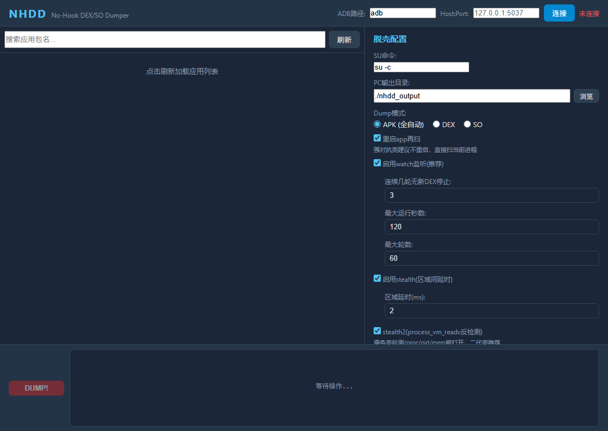
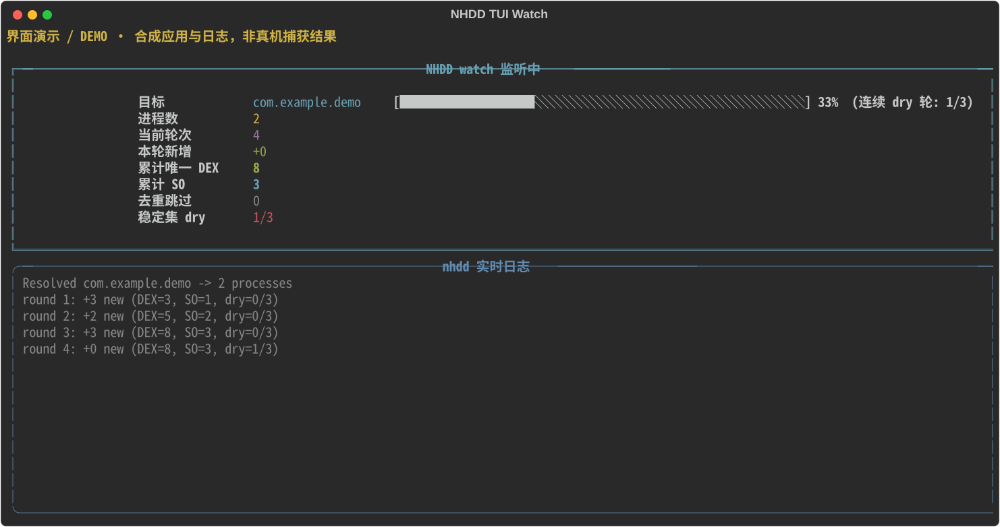
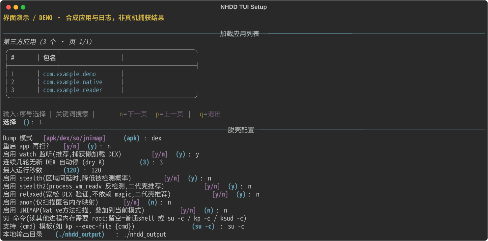

<h1 align="center">NHDD</h1>

<strong>面向 Android Root 的运行时 DEX / SO 提取工具，不向目标进程注入。</strong>

  
  
  
  

  <a href="https://github.com/Fruit-Guardians/NHDD/releases/latest">下载</a> ·
  <a href="./NHDD-cpp-modular/README.md">使用说明</a> ·
  <a href="./NHDD-cpp-modular/docs/design.md">架构设计</a> ·
  <a href="./README.md">English</a>

## 能做什么

- 多轮捕获 DEX，记录覆盖率、缺页和内容 revision。
- 基于已适配 ART 对象发现 DEX，安全合并短暂明文方法窗口，保留来源和冲突记录。
- 按 PT_LOAD / load bias 重建 ELF32/64 SO 文件。
- 启动前跟踪、包内多进程跟随、tracefs 事件驱动及 maps 增量扫描。
- 保留 CompactDex / VDEX / OAT 原生证据，支持 OAT 279 和离线结构检查。
- 提供独立 Android CLI、Python TUI 和 Windows GUI；控制端尚未覆盖全部高级 CLI 参数。

## 快速使用

从 Releases 下载匹配的包并核对 SHA256SUMS.txt。主要设备目标为 ARM64、构建最低 API 34；需要 ADB、Root 及读取目标进程的权限。

~~~bash
adb shell "su -c id"
adb push nhdd /data/local/tmp/nhdd
adb shell chmod 755 /data/local/tmp/nhdd
adb shell "su -c '/data/local/tmp/nhdd com.example.app /data/local/tmp/nhdd_run01 --all --watch 3'"
adb pull /data/local/tmp/nhdd_run01 ./nhdd_run01
~~~

将 com.example.app 替换为自有或明确获授权的应用。每次使用新输出目录，避免默认清理旧产物。ART、冷启动、事件模式和输出解释见[完整使用指南](./NHDD-cpp-modular/README.md)。

## 界面预览

### Windows GUI

实际 GUI 前端的浏览器预览，尚未连接设备；不展示私有设备标识或转储，不替代原生 WebView2 测试。

### Python TUI

应用选择 → 参数配置 → watch 实时进度 → 结果统计。安装 rich 后运行 `python nhdd_tui.py`；支持 `python nhdd_tui.py com.example.app` 直接选择目标。

查看应用选择与参数配置

两张 TUI 图由实际 Rich 界面函数生成；包名、输入和日志均为演示数据，不是 Root 真机捕获结果。可运行 `python scripts/capture_tui.py` 重新生成。

## 架构概览

~~~mermaid
flowchart LR
  UI["TUI / GUI"] -->|"ADB + su"| CLI["Root C++ CLI"]
  CLI --> CAP["Fast capture / DEX-SO-JNI scans"]
  APP["App memory / ART"] -->|"External reads"| CAP
  EV["tracefs / maps diff"] --> CAP
  CAP --> CHECK["Identity / coverage / format checks"]
  CHECK --> REC["PT_LOAD rebuild / safe ART merge"]
  REC --> OUT["DEX / SO / metadata / timeline"]
~~~

扫描器位于目标进程之外；各路径执行相应身份、覆盖或一致性检查。跨窗口方法合并明确标记为跨时刻证据，不冒充原子快照。[实现细节与安全边界](./NHDD-cpp-modular/docs/design.md)。

## 包与文档

| 入口 | 使用方式 |
|---|---|
| Android CLI | [功能、参数和产物说明](./NHDD-cpp-modular/README.md) |
| Python TUI | Python 3.10+、rich；运行 nhdd_tui.py |
| Windows GUI | ADB、WebView2 Runtime；EXE 旁保留包内 Android 引擎 |
| 构建与安全 | [构建说明](./BUILD_WINDOWS.md) · [依赖审计](./NHDD-cpp-modular/docs/dependency-security.md) |

ARMv7 仅交叉编译；16KiB 页设备未验证。ART 恢复依赖已适配 Build ID，短暂窗口仍可能漏捕。无 Hook 不等于不可检测；结构有效不等于方法已解密或 APK 可运行。

[MIT](./LICENSE)，保留第三方许可。项目：[Fruit-Guardians/NHDD](https://github.com/Fruit-Guardians/NHDD)。仅用于自有或明确获授权的应用。
